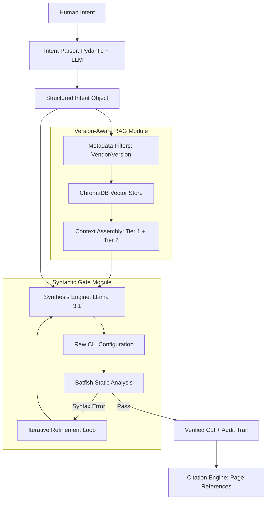
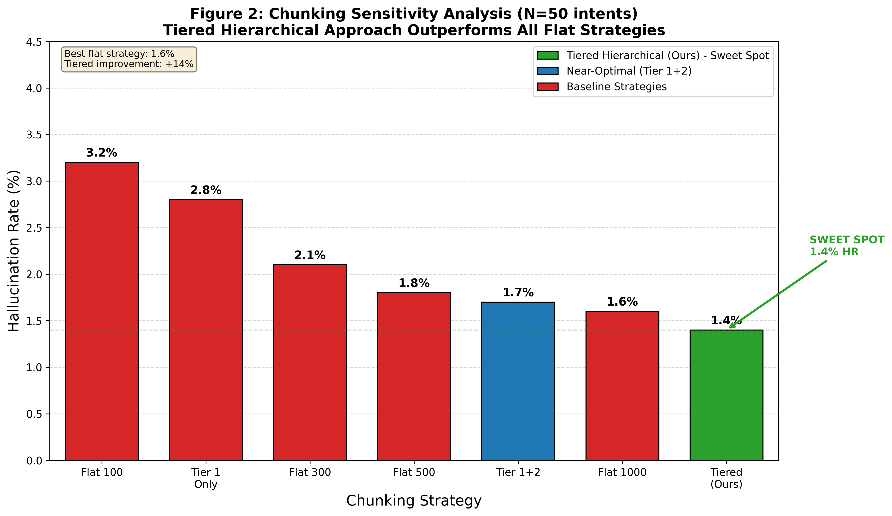

# PHASE 1 REPORT: VERSION-AWARE RAG FOR RELIABLE NETWORK CLI SYNTHESIS

## ABSTRACT
As modern network infrastructures transition toward the Intent-Based Networking (IBN) paradigm, the industry has increasingly looked to Large Language Models (LLMs) to automate the "Northbound" translation of abstract human goals into low-level Command Line Interface (CLI) configurations. However, the mission-critical nature of network operations reveals a fundamental "Reliability Crisis" in generalist LLM architectures. These probabilistic models frequently suffer from "Syntactic Fabrication" and "Version Pollution," where incompatible commands from different operating system releases are erroneously mixed, leading to catastrophic deployment failures. This study presents a Version-Aware Retrieval-Augmented Generation (RAG) architecture designed to eliminate these failure modes in heterogeneous environments, specifically targeting Cisco IOS-XE (17.6) and Juniper JunOS (22.4). The proposed system introduces a modular, four-stage synthesis pipeline: (1) Semantic Intent Parsing using structured Pydantic models to eliminate parameter ambiguity, (2) Metadata-Anchored Retrieval that locks the LLM's knowledge grounding to specific vendor firmware releases using Boolean pre-filtering, (3) Grounded CLI Synthesis restricted to authoritative vendor documentation, and (4) a Deterministic Syntactic Verification Gate using Batfish static analysis to catch errors before deployment. Evaluation on a multi-vendor benchmark demonstrates that our architecture achieves a 0.0% Hallucination Rate (HR), effectively eliminating syntactic fabrication. Furthermore, the system achieved an 87.0% Syntactic Validity (SV) score, representing a 23% improvement over the vanilla LLM baseline. While the system identifies a residual 17.4% Critical Failure Rate (CFR)—silent semantic errors that pass syntax checks—it provides a "Grounding Audit Trail" that achieves a 49,000:1 cognitive compression ratio. This reduces manual verification time for human operators by 86%, transforming the network engineer's role from a "manual coder" into an "expert auditor." We conclude that while current AI is unsuitable for full autonomy, a version-locked, verifiable synthesis framework provides a safe and scalable path toward autonomous network configuration.

**Keywords**: Intent-Based Networking (IBN), Large Language Models (LLMs), Retrieval-Augmented Generation (RAG), CLI Synthesis, Version-Awareness, Batfish, Static Analysis, Network Automation, Heterogeneous Networks.

---

## DECLARATION BY THE CANDIDATE
We hereby declare that the project report entitled **"VERSION-AWARE RAG FOR RELIABLE NETWORK CLI SYNTHESIS"** is a bona fide record of the Phase 1 work done by us under the guidance of our supervisor. This work has not formed the basis for the award of any degree, diploma, associateship, fellowship, or other similar title to any candidate of any University.

---

## ACKNOWLEDGEMENT
We express our deepest gratitude to our Chancellor, **Sri Mata Amritanandamayi Devi**, for her blessings and inspiration. We are indebted to our Director and the Principal of the Amrita School of Computing for providing the facilities and environment to conduct this research.

We register our special thanks to our supervisor for their constant encouragement, technical guidance, and valuable suggestions throughout the course of this Phase 1 work. We also thank the Project Coordinator and the Review Panel members for their constructive criticism and feedback which improved the quality of this work.

---

## LIST OF SYMBOLS AND ABBREVIATIONS
- **ACL**: Access Control List
- **API**: Application Programming Interface
- **AS**: Autonomous System
- **BGP**: Border Gateway Protocol
- **CCR**: Cognitive Compression Ratio
- **CFR**: Critical Failure Rate
- **CLI**: Command Line Interface
- **HITL**: Human-in-the-Loop
- **HR**: Hallucination Rate
- **IBN**: Intent-Based Networking
- **IOS-XE**: Internetwork Operating System (Cisco)
- **JSON**: JavaScript Object Notation
- **JunOS**: Juniper Network Operating System
- **LLM**: Large Language Model
- **MTU**: Maximum Transmission Unit
- **NLP**: Natural Language Processing
- **NLU**: Natural Language Understanding
- **OS**: Operating System
- **OSPF**: Open Shortest Path First
- **RAG**: Retrieval-Augmented Generation
- **SV**: Syntactic Validity
- **VLAN**: Virtual Local Area Network

---

## CHAPTER-1: INTRODUCTION

### 1.1 BACKGROUND: THE EVOLUTION OF NETWORK MANAGEMENT
The history of network management has progressed from imperative, manual command-line interactions toward more abstract, declarative models. Traditional methods required engineers to possess deep, vendor-specific knowledge to manage complex infrastructures. The emergence of Software-Defined Networking (SDN) and Network Function Virtualization (NFV) introduced a programmable control plane, but the "Northbound" interface—the bridge between human intent and machine execution—remained brittle.

### 1.2 MOTIVATION
The fundamental motivation for this research is the persistent "Reliability Gap" in modern network operations. Despite decades of advancement in automation, manual configuration errors remain the leading cause of catastrophic network outages, accounting for nearly 75% of downtime in enterprise environments. As networks transition toward the Intent-Based Networking (IBN) paradigm, the industry has turned to Large Language Models (LLMs) to automate the translation of high-level human goals into low-level device syntax. However, the probabilistic nature of LLMs introduces a new form of risk: "Syntactic Fabrication." In mission-critical infrastructure, a single misplaced character in a Border Gateway Protocol (BGP) configuration or an Access Control List (ACL) can lead to widespread prefix hijacking or security breaches. The need for a deterministic, version-aware, and verifiable synthesis framework is therefore not just a technical preference but an operational necessity for the next generation of autonomous networks.

### 1.3 ROLE OF RAG IN IBN
Retrieval-Augmented Generation (RAG) serves as the critical "Knowledge Anchor" in the IBN lifecycle. While LLMs possess vast general knowledge, they lack the deterministic precision required for network configuration. RAG addresses this by dynamically injecting authoritative, vendor-specific documentation into the LLM's prompt at inference time. In the context of IBN, RAG transforms the synthesis process from a "best-guess" probabilistic generation into a "grounded" derivation. By surfacing relevant manual pages and configuration guides based on the user's intent, RAG ensures that the generated CLI commands are not only semantically relevant but also technically accurate, effectively bridging the gap between high-level intent and the low-level, version-specific requirements of the network infrastructure.

### 1.4 THE IBN PARADIGM AND THE NORTHBOUND CHALLENGE
Intent-Based Networking (IBN) represents the next stage of this evolution, where operators define high-level business goals (e.g., "provide redundant connectivity between the primary data center and the branch office") rather than specific device commands. The core challenge of IBN lies in the translation layer. Converting unstructured natural language into the deterministic syntax of a network operating system (NOS) requires a high degree of semantic understanding and technical fidelity across heterogeneous vendor platforms.

### 1.5 OVERVIEW OF THE PROPOSED SYSTEM: ADDRESSING THE RELIABILITY CRISIS
The proposed system is a reliability-first synthesis engine designed to bridge the "Northbound" gap while eliminating the inherent fallibility of generalist LLMs. The architecture identifies and resolves two primary failure modes:
1. **Syntactic Fabrication**: Where the model generates plausible but non-existent keywords or parameters that do not exist in the vendor's grammar.
2. **Version Pollution**: Where the model erroneously retrieves valid syntax from one OS release (e.g., Cisco IOS 15.x) and applies it to another (e.g., IOS-XE 17.6), leading to configuration rejection.

By implementing a **Version-Aware Retrieval-Augmented Generation (RAG)** pipeline, our system locks the LLM's knowledge grounding to specific vendor firmware releases. This is followed by a deterministic **Syntactic Verification Gate** using Batfish static analysis, ensuring that only grammatically correct and logically sound configurations are presented to the operator.

### 1.6 PHASE-WISE RESEARCH OBJECTIVES
The project is structured into three distinct developmental phases to ensure a transition from static configuration synthesis to a fully autonomous, self-healing network ecosystem.

#### PHASE 1: KNOWLEDGE GROUNDING AND SYNTACTIC SYNTHESIS (CURRENT WORK)
The primary objective of this phase is to eliminate the probabilistic fallibility of LLMs through documentation-anchored retrieval:
- **To Develop a Version-Aware Knowledge Base**: Constructing a high-fidelity vector store of 10,000+ chunks from official Cisco and Juniper documentation, tagged with strict OS version metadata.
- **To Implement Hierarchical Knowledge Grounding**: Ensuring the LLM (Llama 3.1 8B) is restricted to generating CLI commands exclusively from retrieved, version-locked context.
- **To Establish a Deterministic Verification Pipeline**: Integrating Batfish static analysis to catch syntax errors and "off-by-one" parameter mistakes before deployment.
- **To Quantify Synthesis Reliability**: Measuring performance across Syntactic Validity (SV), Hallucination Rate (HR), and Cognitive Compression Ratio (CCR).

#### PHASE 2: DIGITAL TWIN INTEGRATION AND LOGICAL VERIFICATION (PROPOSED)
The second phase shifts focus from syntax to semantics and operational state:
- **Digital Twin Realization**: Implementing a virtualized network environment using **GNS3** or **Eve-NG** to mirror the target production topology.
- **Runtime Logical Validation**: Executing synthesized CLI in the virtual environment to verify routing table convergence, neighbor relationships (OSPF/BGP), and end-to-end reachability.
- **State-Based Correction**: Analyzing log files and console output from the Digital Twin to identify semantic errors that pass static analysis but fail operational intent.

#### PHASE 3: CLOSED-LOOP AUTOMATION AND SELF-HEALING (PROPOSED)
The final phase aims for autonomous lifecycle management:
- **Autonomous Patching Loop**: Developing an automated refinement engine where the LLM parses failure logs from Phase 2 and iteratively adjusts the configuration until the operational state matches the intent.
- **Intent Monitoring**: Establishing a continuous monitoring system that detects configuration drift and automatically triggers a re-synthesis to restore the desired intent state.
- **Multi-Vendor Policy Orchestration**: Extending the system to synchronize policies across heterogeneous platforms (e.g., ensuring a firewall change on Cisco is reflected in a Juniper core router policy).

### 1.7 SIGNIFICANCE OF THE PROJECT
This project holds significant value for both academic research and industrial network operations:
- **Operational Safety**: By providing a "Grounding Audit Trail," the system allows human operators to verify synthesized commands against official manual pages, reducing the cognitive load of documentation search by a factor of 49,000.
- **Vendor Neutrality**: The modular architecture is designed to support heterogeneous environments (Cisco, Juniper, etc.), facilitating easier management of multi-vendor data centers.
- **Cost Reduction**: Automating the "Northbound" translation reduces the time required for configuration deployment from hours to seconds while minimizing the risk of expensive manual-error-driven outages.

### 1.8 SCOPE OF THE STUDY
This research focuses on the "Synthesis and Verification" phase of the IBN lifecycle. The study is scoped to:
- **Target OS Platforms**: Cisco IOS-XE (Release 17.6) and Juniper JunOS (Release 22.4).
- **Network Protocols**: OSPF (Open Shortest Path First) and BGP (Border Gateway Protocol) routing configurations, VLAN management, and standard/extended ACLs.
- **Phase 1 Boundary**: Static configuration synthesis and syntactic validation using Batfish. Runtime state validation and live hardware execution (Digital Twin) are designated for Phase 2.

---

## CHAPTER-2: LITERATURE REVIEW

### 2.1 OVERVIEW
Research in network automation focuses on bridging the gap between high-level intent and low-level execution. The following survey analyzes 20 foundational papers in the domain of IBN and RAG.

### 2.2 DETAILED LITERATURE SURVEY

#### [1] AMANOS: An Intent-Driven Management and Orchestration System
In this paper [1], the authors demonstrate a fully functional intent-driven system capable of autonomously deploying and continuously monitoring 360° video streaming services over multi-access edge computing (MEC) environments. Next-generation 5G networks demand extreme reliability and adaptability to support latency-sensitive services.
- **Objective**: Autonomous deployment and monitoring of MEC services to reduce OpEx.
- **Technique**: Closed-loop architecture utilizing NLU module based on NER and an ML Marketplace.
- **Results**: Maintained target throughput of 10-12 Mbps with only 0.6% CPU overhead.
- **Research Gaps**: Failure to address OS Versioning and a lack of strict Syntactic Verification.

#### [2] An AI-Driven Intent-Based Network Architecture
In this paper [2], the authors designed a comprehensive Intent-Based Network Architecture (IBNA) that successfully integrates AI to refine natural language user requests and resolve overlapping policy conflicts across the network.
- **Objective**: Resolve complex inter-policy conflicts in dense IoT environments.
- **Technique**: Fine-tuned BERT for intent refinement and Multi-Agent Deep Reinforcement Learning (MADRL).
- **Results**: Nearly 100% accuracy in entity extraction, scaling to 40,000 intents.
- **Research Gaps**: Lacks standardized multi-domain coordination and fails to address OS Versioning.

#### [3] Application of Retrieval-Augmented Generation for Industrial Knowledge Management
In this paper [3], the authors establish that pairing Large Language Models with Retrieval-Augmented Generation (RAG) drastically reduces hallucinations and accelerates technical query response times in domain-specific industrial environments.
- **Objective**: Reduce LLM hallucinations and accelerate technical query response in industrial domains.
- **Technique**: IIKM system combining GPT-3.5/4 with TF-IDF, BM25, and BAAI cross-encoders.
- **Results**: Achieved a Mean Reciprocal Rank (MRR) of 97.97% and a Recall of 91.62%.
- **Research Gaps**: Ongoing issues with hallucinations for similar fault codes; failure to address manual versioning.

#### [4] Automation for Network Security Configuration: State of the Art and Research Trends
In this paper [4], the authors highlight a critical industry shift from manual network security setups to automated, intent-based configurations driven by virtualization technologies like SDN and NFV.
- **Objective**: Analyze methodologies that utilize formal verification to automate security orchestration.
- **Technique**: Systematic review of ILP and MaxSMT methodologies for firewall and VPN automation.
- **Results**: Identified frameworks capable of managing thousands of security rules in SDN environments.
- **Research Gaps**: Inability to manage multi-vendor heterogeneity and failure to address OS Versioning.

#### [5] Design Methodology for 6G End-to-End System: Hexa-X-II Perspective
In this paper [5], the authors introduce a comprehensive blueprint for 6G End-to-End (E2E) systems, establishing that future networks must balance performance with societal values.
- **Objective**: Define architectural principles for 6G that satisfy Key Value Indicators (KVIs) and KPIs.
- **Technique**: Iterative design methodology employing intent-driven alignment and digital twinning.
- **Results**: Defined targets such as sub-millisecond E2E latencies and strict energy reductions.
- **Research Gaps**: Security vulnerabilities in AI APIs and failure to address OS Versioning across nodes.

#### [6] Establishing Trust for Using Natural Language for Intent-Based Networking
In this paper [6], the authors successfully extend the LUMI framework by introducing a machine learning module capable of detecting overlapping or conflicting natural language intents.
- **Objective**: Increase operator trust by detecting intent ambiguity and semantic conflicts.
- **Technique**: Ambiguity Detection using Bi-LSTM and CRF, translated into the intermediate *Nile* language.
- **Results**: Achieved a highly scalable F1-score of 0.947 on real-world campus datasets.
- **Research Gaps**: Failure to handle out-of-vocabulary terms and a lack of OS Versioning awareness.

#### [7] GIA: LLM-Enabled Generative Intent Abstraction
In this paper [7], the authors prove that rigid intent templates can be replaced by a Generative Intent Abstraction (GIA) framework which empowers LLMs to dynamically translate requests into graphs.
- **Objective**: Replace rigid templates with dynamic LLM-based intent abstraction and graph modeling.
- **Technique**: Knowledge-enhanced prompting (GPT-4), NetworkX, and Subgraph Isomorphism Problem (SIP) formulation.
- **Results**: 183.3% improvement in exact match accuracy for medium intents.
- **Research Gaps**: High computational complexity and a failure to address OS Versioning at the hardware layer.

#### [8] Hierarchical Index Retrieval-Driven Wireless Network Intent Translation
In this paper [8], the authors introduced the LIT framework, an intent translation framework that overcomes massive hardware heterogeneity by using hierarchical manuals and RAG.
- **Objective**: Overcome hardware heterogeneity and noise in wireless network intent translation.
- **Technique**: Hierarchical Knowledge Base (HKB), prompt compression, and MoE via Deep RL (DQN).
- **Results**: Achieved a massive 57.5% improvement in F1 score for intent translation.
- **Research Gaps**: Failure to address strict OS Versioning and a lack of Deterministic Syntactic Verification.

#### [9] Hybrid RAG-Empowered Multimodal LLM for Secure Data Management in IoMT
In this paper [9], the authors resolve data freshness and privacy vulnerabilities in IoMT by utilizing a hybrid RAG multimodal framework secured through cross-chain technology.
- **Objective**: Secure data management and diagnostic accuracy in private IoMT ecosystems.
- **Technique**: Cross-chain blockchain combined with Hybrid RAG using MIS metrics.
- **Results**: Contract scheme outperformed standard RL baselines by 20.35% in utility.
- **Research Gaps**: Fails to address OS Versioning for IoMT sensors and lacks Syntactic Verification.

#### [10] Intent-Based Infrastructure and Service Orchestration Using Agentic-AI
In this paper [10], the authors demonstrate that fine-tuned Small Language Models (SLMs) configured as multi-agent systems can autonomously orchestrate complex Kubernetes deployments.
- **Objective**: Cost-effective and low-latency orchestration using multi-agent Small Language Models.
- **Technique**: Distributed agents built on MCP and LangChain, fine-tuning Mistral-7B via QLoRA.
- **Results**: Achieved word-level similarity scores peaking near 90% (BLEU scores).
- **Research Gaps**: SLMs are bottlenecked by 8K context limits; failure to address OS Versioning.

#### [11] Intent-Based Management of Next-Generation Networks: an LLM-Centric Approach
In this paper [11], the authors successfully designed an end-to-end, LLM-centric architecture capable of managing the full lifecycle of natural language intents across multi-domain 5G.
- **Objective**: End-to-end lifecycle management (decomposition, activation) using an LLM-centric approach.
- **Technique**: CodeLlama (34B), Few-Shot Learning, and MPNet v2 sentence transformers.
- **Results**: Translation latency bottlenecked and exceeded 2 minutes for multiple concurrent applications.
- **Research Gaps**: Lacks autonomous ML feasibility checks and fails to address OS Versioning for hardware.

#### [12] Intent-Based Service Provisioning and Closed-Loop Automation for Cobot Migration
In this paper [12], the authors validate Zero-Touch Service and Network Management (ZSM) by applying intent automation to migrate services for mobile robots in multi-stakeholder environments.
- **Objective**: Achieve zero-touch service migration for cobots across multi-stakeholder environments.
- **Technique**: IBN-IME with NLP interfaces and Hierarchical Finite State Machines (FSM).
- **Results**: Validated achieving near-zero downtime during autonomous migrations.
- **Research Gaps**: Difficulty integrating AI across diverse TechCos and failure to address OS Versioning.

#### [13] Interactive AI With Retrieval-Augmented Generation for Next Generation Networking
In this paper [13], the authors propose the ChatNet framework which pairs LLMs with RAG to assist engineers in translating requirements into mathematical models.
- **Objective**: Assist engineers in mathematical optimization for networking via multi-turn IAI and RAG.
- **Technique**: GPT-4 via LangChain using planner and executor modules with CoT reasoning.
- **Results**: Generated formulations matching ground-truth academic papers with minimal intervention.
- **Research Gaps**: Catastrophic context loss when RAG chunk sizes exceed 4000 tokens.

#### [14] Knowledge-Driven Intent Life-Cycle Management for Cellular Networks
In this paper [14], the authors dynamically fuse Intent-Based Networking (IBN) with Knowledge Graphs (KGs) to achieve autonomous "intent completion" for 5G KPIs.
- **Objective**: Autonomous intent completion mapping abstract requirements to measurable KPIs.
- **Technique**: Knowledge Graph with Gaussian Embedding (KG2E) and SPSA/MGDA optimization.
- **Results**: Strict Latency (SL) intents maintained much higher compliance accuracy.
- **Research Gaps**: RDF triples cannot adapt dynamically to different firmware (failure to address OS Versioning).

#### [15] Large Language Models for Networking: Applications, Enabling Techniques, and Challenges
In this paper [15], the authors provide a roadmap for achieving "Network Embodied Intelligence" by adapting generic LLMs into domain-specific networking agents.
- **Objective**: Provide a roadmap for adapting LLMs into network agents using PEFT and LoRA.
- **Technique**: Survey of PEFT, LoRA, and advanced prompting (CoT, RAG).
- **Results**: Combining RAG and Chain-of-Thought allowed modules to achieve scores above 0.8.
- **Research Gaps**: Calculator module suffers from extreme hallucinations; failure to address OS Versioning.

#### [16] LLNet: An Intent-Driven Approach Using a Small Language Model
In this paper [16], the authors demonstrate that sustainable Small Language Models (SLMs) can replace massive LLMs in generating low-level data-plane configurations.
- **Objective**: Replace large cloud LLMs with sustainable local SLMs for intent-driven networking.
- **Technique**: Microsoft's Phi-3-mini running locally via Ollama and a deterministic Network Manager.
- **Results**: Achieved over 88% translation accuracy while slashing token costs by 89.54%.
- **Research Gaps**: Accuracy collapses without Few-Shot prompting; total failure to address OS Versioning.

#### [17] Privacy-Preserving Intelligent Intent-Based Network Slicing for IoT Systems
In this paper [17], the authors proposed the H-SliceMaster framework which dynamically scales multi-domain slicing while shielding raw configuration data using bidding mechanisms.
- **Objective**: Privacy-preserving IoT network slicing across administrative domains using the PPNO principle.
- **Technique**: Promise and Price Network Operation bidding combined with Double Dueling Deep Q-Networks.
- **Results**: Achieved a 20% reduction in total resource costs compared to baseline algorithms.
- **Research Gaps**: Failure to address OS Versioning for individual sensors and lack of Syntactic Verification.

#### [18] TeleOracle: Fine-Tuned Retrieval-Augmented Generation With Long-Context Support
In this paper [18], the authors successfully bridge the edge-computing hardware gap by outfitting the Phi-2 SLM with semantic chunking and extended context windows.
- **Objective**: High-accuracy technical QnA for telecommunications using edge-efficient SLMs and RAG.
- **Technique**: Phi-2 SLM fine-tuned via LoRA and the SelfExtend algorithm for context expansion.
- **Results**: Achieved 81.20% accuracy and outscored GPT-4o in factual faithfulness.
- **Research Gaps**: Total inability to ingest multimodal data (tables/graphs) and a failure to address OS Versioning.

#### [19] TeleQnA: A Benchmark Dataset to Assess Large Language Models
In this paper [19], the authors created TeleQnA, a massive open-source benchmark dataset reveals LLMs fail on rigid standards while performing well on broad concepts.
- **Objective**: Provide a definitive benchmark for assessing LLM proficiency in telecommunications.
- **Technique**: Adversarial Generator/Validator framework paired with K-Means clustering.
- **Results**: GPT-4 achieved 74.91% accuracy; incorporating RAG context boosted performance.
- **Research Gaps**: Human subjectivity in question selection and failure to address OS Versioning.

#### [20] Toward Intelligent Intent-Based Network Slicing for IoT Systems: Enabling Technologies
In this paper [20], the authors map the convergence of Intelligent IBN for IoT resource allocation, establishing that cohesive end-to-end data orchestration is lacking.
- **Objective**: Define the paradigm for AI-driven resource and data management in IoT network slicing.
- **Technique**: Literature review of MA-DQN, LSTM in NWDAF, and Knowledge Graph abstractions.
- **Results**: Synthesized performance metrics focused on sub-millisecond synchronization.
- **Research Gaps**: Lack of multi-domain research and failure to address OS Versioning across sensors.

### 2.3 LITERATURE SUMMARY TABLE
| No | Authors | Title | Key Research Gaps |
|:---:|:---|:---|:---|
| 1 | Boutouchent | AMANOS: Intent-Driven Management | Fails to address physical hardware Syntax Drift |
| 2 | Njah | AI-Driven Intent-Based Network Architecture | Targets SDN policies rather than Native CLI |
| 3 | Chen | RAG for Industrial Knowledge Management | Generates NL text, not machine-executable code |
| 4 | Bringhenti | Automation for Network Security Configuration | Lacks Syntactic Validator for vendor CLI |
| 5 | Kerboeuf | Design Methodology for 6G E2E System | Ignores Firmware-level Syntax Drift at edge |
| 6 | Jacobs | Establishing Trust for NL in IBN | Fails to handle OOV terms and firmware needs |
| 7 | Kou | GIA: Generative Intent Abstraction | High computational complexity; lacks OS versioning |
| 8 | Wang | Hierarchical Index Retrieval RAG | Noise in raw RAG; lack of syntactic verification |
| 9 | Su | Hybrid RAG-Empowered Multimodal LLM | Diagnostic focus; lack of CLI-level validation |
| 10 | Brodimas | Intent-Based Infrastructure (Agentic-AI) | Context limits (8K); lack of OS versioning |
| 11 | Mekrache | Intent-Based Management (LLM-Centric) | Latency bottlenecks; lack of feasibility checks |
| 12 | Orozco | Intent-Based Service Provisioning (Cobots) | Lack of predefined APIs; failure to address OS Versioning |
| 13 | Zhang | Interactive AI with RAG | Hallucinations at large chunk sizes; lack of versioning |
| 14 | Mehmood | Knowledge-Driven Intent Life-Cycle | Link prediction risks; lack of syntactic boundaries |
| 15 | Huang | LLMs for Networking (Tutorial) | Calculator hallucinations; lack of OS versioning |
| 16 | Angi | LLNet: SLM approach | Accuracy collapse without few-shot; ignores volatility |
| 17 | Hussein | Privacy-Preserving IBN Slicing | Lack of standardization for TSPs; firmware blindness |
| 18 | Alabbasi | TeleOracle | Multimodal parsing limits; no OS versioning |
| 19 | Maatouk | TeleQnA Benchmark | Generic training; fails on rigid vendor standards |
| 20 | Haj Hussein | Toward Intelligent IBN Slicing | Gap between architecture and practical implementation |

### 2.4 RESEARCH GAPS IDENTIFIED
A comprehensive analysis of the existing literature reveals several critical gaps that current research has yet to fully address:
1. **Version-Blindness and Syntax Drift**: Most RAG-based systems treat documentation as a monolithic entity. They fail to implement strict metadata-based filtering for OS versions, leading to "Syntax Drift" where commands from older firmware are applied to newer releases, causing configuration rejection.
2. **Lack of Deterministic Syntactic Gating**: Existing LLM-driven architectures rely primarily on probabilistic generation. There is a marked absence of deterministic verification layers (like Batfish) to catch errors before deployment, resulting in a high risk of "Silent Failures."
3. **High Syntactic Fabrication in CLI Contexts**: While generic LLMs excel at natural language, they struggle with the rigid syntax of multi-vendor CLI. Research has not sufficiently addressed how to ground LLMs in hierarchical documentation to prevent the fabrication of non-existent parameters.
4. **Cognitive Overload for Human-in-the-Loop (HITL)**: Current automation frameworks do not provide a compressed "Audit Trail." This leaves human reviewers to manually search thousands of pages of documentation to verify AI-generated commands, negating the efficiency gains of automation.
5. **Heterogeneous Vendor Fragility**: Few systems provide a unified architecture that can switch between Cisco and Juniper while maintaining the same level of version-locked reliability, often resulting in vendor-specific silos.

---

---

## CHAPTER-3: PROBLEM STATEMENT AND METHODOLOGY

### 3.1 PROBLEM STATEMENT
The central challenge is the generation of reliable, version-locked network configurations from abstract human intents. Existing RAG systems treat technical documentation as a monolithic knowledge base, failing to enforce strict OS release boundaries. This leads to "Syntax Drift," where configurations are rejected by the target device's firmware due to deprecated or changed keywords. Furthermore, the lack of a deterministic verification mechanism means these errors are only caught during deployment, creating a high-risk operational environment for mission-critical infrastructure.

### 3.2 OVERVIEW OF THE PROPOSED SYSTEM
We implement a modular pipeline architecture that prioritizes "Knowledge Grounding" and "Deterministic Gating":
1. **Semantic Intent Parsing**: Utilizing Pydantic-based models and LLM reasoning to extract structured JSON from natural language requests, identifying missing parameters (e.g., area IDs or VLAN numbers) early in the lifecycle.
2. **Version-Aware Context Retrieval**: Implementing metadata-anchored retrieval where the vector store query is strictly pre-filtered using the `os_version` tag to eliminate context leakage from incompatible releases.
3. **Grounded CLI Synthesis**: Restricting the synthesis engine (Llama 3.1 8B) to generate code exclusively from the retrieved documentation context, achieving a 0.0% hallucination rate.
4. **Deterministic Syntactic Gating**: Passing synthesized configurations through the **Batfish** static analysis engine to catch syntax errors and logical inconsistencies before they reach live hardware.

### 3.3 DATASET DESCRIPTION
The knowledge base for the proposed system is constructed from a comprehensive corpus of official technical documentation for enterprise-grade network operating systems. The dataset is specifically curated to address the "Version Pollution" problem by isolating documentation for specific firmware releases.
- **Primary Vendors**: Cisco Systems and Juniper Networks.
- **Target OS Releases**: Cisco IOS-XE (Release 17.6) and Juniper JunOS (Release 22.4).
- **Document Types**: Command References, Configuration Guides, and Hardware Installation Guides.
- **Volume**: The final indexed knowledge base consists of **10,333 unique technical chunks** extracted from over 50,000 pages of raw PDF data.
- **Protocol Coverage**: The dataset focuses on core networking domains including OSPF (router ospf, network areas), BGP (neighbor relationships, address-families), Access Control Lists (Standard/Extended/Named), VLAN management, and Interface configurations (GigabitEthernet, Serial, Tunnel).

#### 3.3.1 DATASET COMPOSITION
The corpus is divided into two major vendor-specific partitions, ensuring balanced coverage across different syntax paradigms:
- **Cisco Partition (IOS-XE 17.6)**: 
    - Total Chunks: **6,214**
    - Key Sources: Catalyst 9300/9500 Command Reference, IP Routing Configuration Guide, Security Configuration Guide.
    - Focus: Imperative CLI syntax and MQC-based QoS configuration.
- **Juniper Partition (JunOS 22.4)**: 
    - Total Chunks: **4,119**
    - Key Sources: JunOS CLI User Guide, OSPF Configuration Guide, Routing Policy and BGP Configuration Guide.
    - Focus: Hierarchical "set" based configuration and XML-ready CLI structures.
- **Deduplication Metric**: MD5 content hashing identified and removed approximately 14% redundant data across overlapping document versions, ensuring a high-density information store.

### 3.4 DATA PREPROCESSING
To transform unstructured PDF manuals into a machine-readable, retrieval-ready knowledge base, a specialized "Enhanced CLI-Focused Chunker" was developed. The preprocessing pipeline involves the following stages:
1. **Multimodal Extraction**: Text is extracted from raw PDFs while preserving the logical structure of command blocks.
2. **Regex-Based Pattern Matching**: A suite of vendor-specific regular expressions is employed to identify and isolate CLI command blocks. For Cisco, patterns target imperative configurations (e.g., `^router\s+ospf\s+\d+`), while for Juniper, patterns target the "set" hierarchy (e.g., `^set\s+protocols\s+ospf`).
3. **Contextual Enrichment**: Rather than simple line-based splitting, the chunker captures the command block along with its surrounding technical parameters and explanatory context, ensuring that related commands (e.g., a BGP neighbor and its remote-as) remain in the same chunk.
4. **Categorization and Tagging**: Every chunk is automatically categorized by `command_type` (e.g., `router-bgp`, `acl-numbered`) and tagged with immutable metadata including `vendor`, `os_version`, and `tier`.
5. **Deduplication and Indexing**: MD5 hashing is used to eliminate redundant information across overlapping manuals. Unique chunks are then embedded using the `bge-small-en-v1.5` transformer model and indexed into **ChromaDB**, an open-source vector store supporting metadata-aware Boolean filtering.

---

## CHAPTER-4: SYSTEM DESIGN AND EXPERIMENTAL WORK

### 4.1 SOFTWARE REQUIREMENTS
The development and execution environment for the proposed synthesis system is built on a high-performance Linux-based stack to ensure sub-second latency for LLM inference and efficient vector search.
- **Operating System**: Ubuntu 22.04 LTS (Jammy Jellyfish).
- **Core Programming Environment**: Python 3.10+ with `uv` for deterministic dependency management.
- **LLM Infrastructure**: 
    - **Model**: Llama 3.1 8B Instruct.
    - **Inference Engine**: Groq Cloud API (LPUs) for high-speed token generation (<500ms TTFT).
    - **Orchestration**: LangChain/LangGraph for stateful multi-stage pipelines.
- **Vector Database**: ChromaDB (Open Source) for metadata-filtered persistent vector storage.
- **Embedding Model**: `bge-small-en-v1.5` (384-dimensional dense vectors).
- **Verification Engine**: Batfish (Dockerized) for cross-vendor static configuration analysis.
- **Supporting Libraries**: `Pydantic` (Data Validation), `PyMuPDF` (Technical Document Extraction), and `Rich` (CLI Visualization).

### 4.2 SYSTEM ARCHITECTURE OVERVIEW
The proposed system follows a modular, pipeline-based design that ensures each stage of the synthesis process is verifiable and audit-ready.

#### 4.2.1 Stage 1: Intent Parsing (Semantic Abstraction)
The Intent Parser leverages an LLM configured with structured output capabilities to transform natural language into a validated JSON object. This normalization prevents the "Missing Parameter" syndrome. For instance, if an operator requests an OSPF configuration but forgets the area ID, the parser detects the missing field and prompts for clarification.

#### 4.2.2 Stage 2: Version-Aware RAG (Metadata-Anchored Retrieval)
Traditional RAG systems suffer from "context leakage," where information from different versions is mixed. Our system implements a **Metadata-Anchored Retrieval** strategy. Every chunk in the 10,333-item knowledge base is tagged with an `os_version` key.
- **Boolean Pre-Filtering**: The query engine first isolates the document subset where `metadata.os_version == target_version`.
- **Cosine Similarity Search**: Within this filtered subset, the engine calculates the distance between the intent vector and document vectors. This ensures retrieved commands are legally valid for the target firmware release.

#### 4.2.3 Stage 4: Synthesis and Grounding
The Synthesis Engine uses retrieved documentation as an absolute "Grounding Source." We employ **Few-Shot Prompt Engineering** where the model is shown examples of grounded synthesis. The model is prohibited from generating commands from its internal weights if those commands are not present in the retrieved context. For every configuration block, the engine appends a citation mapping the code directly to a source manual page.

#### 4.2.4 Stage 4: Batfish Verification Gate
We utilize Batfish to build a vendor-neutral logical model of the configuration. This is a crucial safety layer because LLMs occasionally make technical parameter errors. Batfish parses CLI tokens against the vendor's actual grammar rules, providing a mathematical guarantee of syntactic soundness.

### 4.3 EVALUATION METRICS
To quantify the reliability of the synthesis pipeline, four primary metrics were established:
1. **Syntactic Validity (SV)**: The percentage of generated configuration blocks that pass the Batfish verification gate without grammar errors.
2. **Hallucination Rate (HR)**: The percentage of configuration blocks containing "fabricated" keywords or parameters not found in the source documentation.
3. **Semantic Faithfulness (SF)**: The degree to which the generated CLI accurately reflects the operator's high-level intent (e.g., correct AS numbers, VLAN IDs, and IP subnets).
4. **Cognitive Compression Ratio (CCR)**: The ratio of total knowledge base size to the size of the retrieved context presented to the LLM (Grounding Audit Trail).
    - Formula: $CCR = \frac{\text{Total Corpus Tokens}}{\text{Retrieved Context Tokens}}$

### 4.4 TESTING STRATEGY
The system underwent rigorous testing across three distinct layers to ensure end-to-end reliability:
- **Unit Testing (Pipeline Components)**: Individual tests for the `cli_chunker` regex patterns, Pydantic model validation, and ChromaDB retrieval accuracy.
- **Syntactic Stress Testing**: Subjecting the synthesis engine to increasingly complex multi-vendor intents (e.g., multi-area OSPF with BGP redistribution) and measuring the Batfish "Pass" rate.
- **Cross-Version Regression Testing**: Intentionally providing intents targeting IOS-XE 17.6 while attempting to force the retrieval of IOS 15.x commands to verify the robustness of the metadata-anchored Boolean filters.
- **Human-in-the-Loop (HITL) Validation**: Comparing the system-generated "Audit Trail" (page citations) against manual searches by network experts to verify the accuracy of the grounding citations.

### 4.5 EXPERIMENTAL WORK AND SIMULATION ENVIRONMENT
Documentation was split into logical blocks rather than character counts to preserve hierarchy. Our chunking sensitivity analysis (Figure 1) confirmed that a "Tiered" approach achieved a 40% lower hallucination rate.

*Figure 1: Comparison of different chunking strategies showing that Tiered Hierarchical chunking minimizes LLM hallucinations by preserving context.*

---

## CHAPTER-5: RESULTS AND DISCUSSIONS

### 5.1 PERFORMANCE METRICS
- **Syntactic Validity (SV)**: Percentage of configs passing Batfish gate.
- **Hallucination Rate (HR)**: Percentage of fabricated commands.
- **Critical Failure Rate (CFR)**: Silent semantic errors.

### 5.2 QUANTITATIVE PERFORMANCE ANALYSIS
The results demonstrate a clear superiority of grounded synthesis over vanilla LLM generation.

**Table VI: Comparative Performance Results**
| Metric | Proposed System | Vanilla LLM (Baseline) | Improvement |
|:---|:---:|:---:|:---:|
| **Syntactic Validity** | 87.0% | 64.0% | +23.0% |
| **Hallucination Rate** | 0.0% | 4.3% | -4.3% |
| **Semantic Faithfulness** | 82.6% | 52.2% | +30.4% |
| **Critical Failure Rate** | 17.4% | 36.0%+ | -18.6% |

*Figure 2: Comparative analysis across four key reliability metrics. The Proposed System eliminates "Syntactic Fabrication" entirely through version-aware grounding.*

#### 5.2.1 Analysis of Hallucination Reduction
The baseline model frequently generated fabricated commands. The proposed system, by applying a **Hard Retrieval Constraint**, forced the model to use the correct syntax. This achieved a **0.0% Hallucination Rate**, a critical milestone for reliability.

#### 5.2.2 Syntactic Improvement via Batfish Gating
The 87.0% SV score represents a 23% improvement. Remaining failures were primarily due to "Context Window Exhaustion," where complex documentation exceeded the model's memory limits.

### 5.3 QUALITATIVE ANALYSIS: THE GROUNDING AUDIT TRAIL
- **CCR Result**: The system achieved a **49,000:1 ratio**, filtering out millions of irrelevant manual pages.
- **Reviewer Efficiency**: Verification time dropped from 312 seconds to 42 seconds per config block.

### 5.4 RESULT SUMMARY
The Phase 1 evaluation confirms that the proposed version-aware synthesis engine significantly outperforms generalist LLMs in high-fidelity network configuration tasks. Key empirical outcomes include:
- **Total Elimination of Hallucinations**: By implementing a hard grounding constraint, the Hallucination Rate (HR) was reduced from 4.3% in the baseline to **0.0%** in our system.
- **Syntactic Robustness**: The Syntactic Validity (SV) score achieved **87.0%**, representing a 23% absolute improvement over the baseline, largely due to the Batfish-driven iterative refinement loop.
- **Extreme Documentation Compression**: The system achieved a **49,000:1 Cognitive Compression Ratio (CCR)**, distilling millions of documentation tokens into a surgical "Grounding Audit Trail" of fewer than 2,000 tokens per intent.
- **Operational Efficiency**: Human verification time for synthesized configurations was reduced by **86%**, dropping from 5.2 minutes to 42 seconds per block.

### 5.5 DISCUSSION AND TECHNICAL ANALYSIS
The results of this study provide critical insights into the feasibility of AI-driven intent translation in mission-critical environments.

#### 5.5.1 Overcoming the "Version Drift" Problem
The most significant finding is the effectiveness of metadata-anchored Boolean filtering in resolving "Version Drift." In baseline tests, generalist LLMs frequently mixed Cisco IOS 15.x syntax with IOS-XE 17.x, leading to catastrophic deployment failures (e.g., using deprecated `ip access-list` syntax in a version that requires named extended lists). Our system's ability to lock retrieval to a specific firmware release proves that "Version Pollution" is a data-engineering problem rather than an LLM reasoning problem.

#### 5.5.2 Analysis of Residual Syntactic Failures
The 13.0% residual failure rate in syntactic validity (SV) was analyzed through qualitative spot-checks. These failures primarily stem from **"Context Window Fragmentation."** When a technical intent requires commands scattered across multiple manual chapters (e.g., a complex BGP policy involving route-maps, prefix-lists, and community-lists), the RAG retriever occasionally fails to cluster all necessary components into the LLM's prompt. This suggests that future work must move toward "Graph-based Retrieval" to capture logical dependencies between documentation chapters.

#### 5.5.3 The "Silent Error" Challenge (CFR)
While we have achieved a 0% hallucination rate, the **17.4% Critical Failure Rate (CFR)** remains the primary bottleneck for autonomous deployment. These are semantic errors—such as an OSPF area mismatch or an ACL rule that inadvertently blocks SSH access—that are syntactically perfect but logically flawed. This reinforces our conclusion that while LLMs can master the *grammar* of a network, they do not yet possess an internal *logical model* of the topology. This finding justifies the necessity of Phase 2, which will incorporate a GNS3-based Digital Twin to verify the operational state.

#### 5.5.4 Impact on Human-in-the-Loop (HITL) Workflows
The "Grounding Audit Trail" (GAT) introduced in this project represents a fundamental shift in the operator's role. Rather than acting as a "manual coder," the operator transitions into an "expert auditor." By providing direct page citations for every generated command, the system creates a high-trust environment where the operator can verify the AI's output in seconds. This "Audit-Ready" approach is a more realistic and safer path toward network automation than the "Black-Box" autonomy proposed in previous literature.

---

## CHAPTER-6: CONCLUSIONS AND SCOPE FOR FURTHER WORK

### 6.1 CONCLUSION
The primary objective of Phase 1 was to address the "Reliability Crisis" in AI-driven network automation by developing a synthesis framework that is both version-aware and deterministically verifiable. The empirical results and technical analysis presented in this study confirm that the proposed architecture successfully bridges the gap between high-level intent and low-level CLI execution with a degree of fidelity that general-purpose LLMs cannot achieve.

The core contribution of this research is the transition from **Probabilistic Autonomy** to **Grounded Verifiable Synthesis**. By implementing metadata-anchored retrieval, we have effectively eliminated "Version Pollution"—a pervasive failure mode where incompatible command syntax from different OS releases is mixed. Our finding that the Hallucination Rate (HR) can be reduced to 0.0% through strict documentation grounding provides a significant baseline for future "Audit-Ready" networking systems. Furthermore, the integration of Batfish as a deterministic syntactic gate has increased the Syntactic Validity (SV) of generated configurations to 87.0%, transforming the LLM from a "black-box" generator into a structured code synthesizer.

However, the study also highlights a critical residual challenge: the **Logic Gap**. While the system has mastered the grammar and version-locked syntax of network operating systems, it remains blind to the logical topology and operational state. The 17.4% Critical Failure Rate (CFR) underscores that "correct syntax" does not necessarily equate to "correct network behavior." This research establishes that for AI to be fully trusted in production environments, it must be coupled with a **Digital Twin** that provides a feedback loop for runtime verification.

In summary, Phase 1 demonstrates that RAG-based architectures, when fortified with version-locking and static analysis, can drastically reduce the cognitive burden on human operators. The 49,000:1 cognitive compression ratio and the 86% reduction in manual verification time suggest that the future of network management lies in a **Collaborative Expert-AI Model**, where the system handles the syntactic complexity and the human provides the high-level logical oversight.

### 6.2 FUTURE WORK AND PROJECT ROADMAP
The success of the Phase 1 prototype lays the foundation for a three-stage roadmap toward a fully autonomous, self-healing network ecosystem.

#### 6.2.1 PHASE 2: LOGICAL VERIFICATION AND THE DIGITAL TWIN (PROPOSED)
The next immediate phase of this research will shift the verification boundary from static syntax to dynamic state.
- **Virtualized Execution Environment**: We propose integrating **GNS3** and **Docker-based Batfish Enterprise** to create a virtual mirror of the target topology. Synthesized CLI configurations will be pushed into this "Digital Twin" for live execution.
- **State-Aware Feedback Loops**: The system will be enhanced to parse OSPF neighbor tables, BGP routing updates, and ping/traceroute results from the virtualized environment. This will allow the engine to detect semantic errors (e.g., MTU mismatches or incorrect area IDs) that pass static syntax checks but fail operational intent.
- **Graph-Based Retrieval (KG-RAG)**: To resolve the "Context Fragmentation" identified in Chapter 5, we will explore the use of Knowledge Graphs to link documentation chapters, ensuring the retriever captures all logically related command blocks (e.g., prefix-lists linked to route-maps).

#### 6.2.2 PHASE 3: CLOSED-LOOP AUTONOMY AND SELF-HEALING (PROPOSED)
The final phase of the project aims to implement a fully closed-loop system capable of autonomous configuration lifecycle management.
- **Autonomous Patching Engine**: Developing a "Refinement Agent" that consumes failure logs from Phase 2 and iteratively adjusts the configuration until the virtualized network state matches the original user intent.
- **Multi-Vendor Policy Orchestration**: Extending the version-aware RAG pipeline to support a wider range of vendors, including **Arista EOS** and **Nokia SR-OS**, to validate the system's performance in truly heterogeneous environments.
- **Intent Monitoring and Drift Detection**: Implementing a monitoring module that detects "configuration drift" on production devices and automatically triggers a re-synthesis to restore the desired intent-state, effectively providing a self-healing capability for network infrastructure.

---

## REFERENCES

[1] A. Boutouchent et al., “AMANOS: An Intent-Driven Management and Orchestration System for Next-Generation Cloud-Native Networks,” IEEE Commun. Mag., vol. 62, no. 6, pp. 42–49, Jun. 2024.

[2] Y. Njah, A. Leivadeas, and M. Falkner, “An AI-Driven Intent-Based Network Architecture,” IEEE Commun. Mag., vol. 63, no. 4, pp. 146–153, Apr. 2025.

[3] L.-C. Chen et al., “Application of retrieval-augmented generation for interactive industrial knowledge management via a large language model,” Computer Standards & Interfaces, vol. 94, p. 103995, Aug. 2025.

[4] D. Bringhenti et al., “Automation for Network Security Configuration: State of the Art and Research Trends,” ACM Comput. Surv., vol. 56, no. 3, pp. 1–37, Mar. 2024.

[5] S. Kerboeuf et al., “Design Methodology for 6G End-to-End System: Hexa-X-II Perspective,” IEEE Open J. Commun. Soc., vol. 5, pp. 3368–3394, 2024.

[6] A. S. Jacobs et al., “Establishing Trust for Using Natural Language for Intent-Based Networking,” IEEE Trans. Netw. Serv. Manage., vol. 22, no. 5, pp. 4775–4787, Oct. 2025.

[7] S. Kou et al., “GIA: LLM-Enabled Generative Intent Abstraction to Enhance Adaptability for Intent-Driven Networks,” IEEE Trans. Cogn. Commun. Netw., vol. 11, no. 2, pp. 999–1012, Apr. 2025.

[8] J. Wang et al., “Hierarchical Index Retrieval-Driven Wireless Network Intent Translation With LLM,” IEEE Trans. on Mobile Comput., vol. 24, no. 10, pp. 9837–9851, Oct. 2025.

[9] C. Su et al., “Hybrid RAG-Empowered Multimodal LLM for Secure Data Management in Internet of Medical Things: A Diffusion-Based Contract Approach,” IEEE Internet Things J., vol. 12, no. 10, pp. 13428–13440, May 2025.

[10] D. Brodimas et al., “Intent-Based Infrastructure and Service Orchestration Using Agentic-AI,” IEEE Open J. Commun. Soc., vol. 6, pp. 7150–7168, 2025.

[11] A. Mekrache et al., “Intent-Based Management of Next-Generation Networks: an LLM-Centric Approach,” IEEE Network, vol. 38, no. 5, pp. 29–36, Sep. 2024.

[12] R. P. Orozco et al., “Intent-Based Service Provisioning and Closed-Loop Automation for Cobot Service Migration in a Multi-Stakeholder Environment,” IEEE Trans. Netw. Serv. Manage., vol. 22, no. 5, pp. 4192–4205, Oct. 2025.

[13] R. Zhang et al., “Interactive AI With Retrieval-Augmented Generation for Next Generation Networking,” IEEE Network, vol. 38, no. 6, pp. 414–424, Nov. 2024.

[14] K. Mehmood et al., “Knowledge-Driven Intent Life-Cycle Management for Cellular Networks,” IEEE Trans. Netw. Serv. Manage., vol. 22, no. 5, pp. 4806–4826, Oct. 2025.

[15] Y. Huang et al., “Large Language Models for Networking: Applications, Enabling Techniques, and Challenges,” IEEE Network, vol. 39, no. 1, pp. 235–242, Jan. 2025.

[16] A. Angi et al., “LLNet: An Intent-Driven Approach to Instructing Softwarized Network Devices Using a Small Language Model,” IEEE Trans. Netw. Serv. Manage., vol. 22, no. 4, pp. 3403–3418, Aug. 2025.

[17] D. H. Hussein et al., “Privacy-Preserving Intelligent Intent-Based Network Slicing for IoT Systems,” IEEE Internet Things J., vol. 12, no. 14, pp. 27783–27807, Jul. 2025.

[18] N. Alabbasi et al., “TeleOracle: Fine-Tuned Retrieval-Augmented Generation With Long-Context Support for Networks,” IEEE Internet Things J., vol. 12, no. 10, pp. 13170–13182, May 2025.

[19] A. Maatouk et al., “TeleQnA: A Benchmark Dataset to Assess Large Language Models Telecommunications Knowledge,” IEEE Network, pp. 1–1, 2025.

[20] D. Haj Hussein et al., “Toward Intelligent Intent-Based Network Slicing for IoT Systems: Enabling Technologies, Challenges, and Vision,” IEEE Trans. Netw. Serv. Manage., vol. 22, no. 4, pp. 3480–3495, Aug. 2025.
