# Development Notes

## pyATS on Windows
Note: pyats is not natively supported on Windows. For validation tasks requiring pyats, please use WSL2 or a Linux container.

## Environment Setup
Dependencies have been installed using uv with Python 3.10.
To activate the environment: .venv\Scripts\activate

```mermaid
architecture-beta
    group user_layer(mdi:account-group)[User Interaction]
    group rag_engine(mdi:brain)[RAG and Agent Logic]
    group storage_layer(mdi:database)[Knowledge Base]
    group network_layer(logos:cisco)[Infrastructure]

    service user(mdi:keyboard)[Intent Interface] in user_layer
    
    service retriever(mdi:file-find)[Retriever] in rag_engine
    service agent(mdi:robot-confused)[Llama Agent] in rag_engine
    
    service manuals(mdi:file-document)[Manuals] in storage_layer
    service embed(mdi:vector-combine)[Embed] in storage_layer
    service vdb(mdi:database-search)[Vector DB] in storage_layer

    service cli(mdi:console-line)[CLI Commands] in network_layer

    %% Using specific ports to avoid label overlap
    user:R -- L:retriever
    manuals:R -- L:embed
    embed:R -- L:vdb
    vdb:T -- B:retriever
    retriever:R -- L:agent
    agent:B -- T:cli

```

