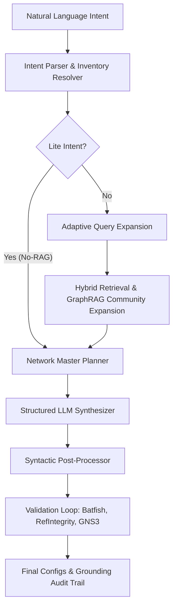

# Research Specification: RAG-NetTwin (Hallucination-Mitigated Intent-Based Networking)

This document provides a comprehensive, research-focused technical specification of the **RAG-NetTwin** framework. It details the architecture, mathematical formulations, algorithmic implementations, multi-tier validation loops, and empirical evaluation metrics of the project based on the codebase, omitting any direct dependencies on the drafts inside the `Paper/` directory.

---

## 1. Research Overview & Motivation

The central goal of **RAG-NetTwin** is to address the **Reliability Crisis** in Artificial Intelligence-driven Intent-Based Networking (IBN). While Large Language Models (LLMs) excel at translating natural language intents into technical specifications, their deployment in production networks is severely limited by three key failure modes:
1. **Syntactic Fabrication**: Generating CLI syntax that does not exist or is invalid for the target firmware.
2. **Version Pollution**: Synthesizing configuration commands that are valid on one software release (e.g., Cisco IOS 15.6) but fail on another (e.g., Cisco IOS-XE 17.6) due to deprecated keywords or command drift.
3. **Multi-Vendor Semantic Inconsistency**: Generating configurations for link peers (e.g., Cisco OSPF peer connected to Juniper OSPF peer) that fail to establish adjacency due to mismatched parameters (e.g., mismatched subnets, hello-timers, or area assignments).

RAG-NetTwin mitigates these issues through an **OS Version-Locked Retrieval-Augmented Generation (RAG)** pipeline combined with **Community-Aware GraphRAG**, **Network Master Planning**, and a **Deterministic Multi-Tier Validation Loop**.

---

## 2. Core Architectural Design

The system is structured as an intent-to-configuration compiler with validation gates. The logical architecture consists of the following phases:



### 2.1 Inventory Resolution & Version-Locking
The `InventoryResolver` ([inventory_resolver.py](file:///home/aryan/Projects/RAG-NetTwin/src/parser/inventory_resolver.py)) decouples intent compilation from static device assumptions. When an intent is submitted, the resolver maps hostnames to specific device facts (Vendor, OS Type, OS Version) using a prioritized resolution strategy:
1. **Local Inventory Map**: Inspects a static JSON database mapping hostnames to metadata.
2. **Live Telemetry Query**: Uses a live connection (via NAPALM) to query the physical device for active facts.
3. **Safe Default Fallback**: Defaults to Cisco IOS-XE 17.6.

These device facts are embedded directly into the retrieval query metadata to force strict filtering of vector chunks.

---

## 3. Algorithmic Specifications

### 3.1 Adaptive Query Expansion & Pilot Retrieval
To avoid token bloat and latency overhead during retrieval, RAG-NetTwin implements an **Adaptive Query Expansion** algorithm ([config_generator.py:L237-266](file:///home/aryan/Projects/RAG-NetTwin/src/rag/config_generator.py#L237-266)).

```python
# Adaptive Expansion Algorithm
pilot_results = vector_store.hybrid_retrieve(query=base_query, vendor=vendor, os_version=version, n_results=1)

if not pilot_results or pilot_results[0]["distance"] > 0.60:
    # Trigger LLM Query Expansion
    expanded_queries = query_expander.expand(base_query)  # Generates 3 semantic variations
else:
    # Skip expansion, use base_query directly to conserve tokens
    expanded_queries = [base_query]
```

This pilot search filters out high-confidence queries (cosine distance $\le 0.60$), bypassing LLM expansion calls for standard administrative tasks (e.g., changing hostnames, NTP, or description fields) and achieving significant token savings.

### 3.2 Hybrid Search & Cross-Encoder Reranking
Retrieval combines dense vector retrieval and sparse keyword search (BM25) using **Reciprocal Rank Fusion (RRF)**:
1. **Dense Querying**: ChromaDB is queried using sentence-transformer embeddings (Jina-v5 SOTA stack) with metadata filtering configured as:
   $$\text{filter} = \{ \text{vendor} = V, \text{os\_version} = Ver \}$$
2. **Sparse Querying**: The local BM25 index of the document collection (`BM25Okapi`) is queried.
3. **RRF Scoring**:
   $$RRF(d) = \frac{1}{k + R_{\text{dense}}(d)} + \frac{1}{k + R_{\text{BM25}}(d)}$$
   where $k = 60$.
4. **Cross-Encoder Reranking**: The top-ranked results are re-evaluated using a `CrossEncoder` model ([vector_store.py:L169-178](file:///home/aryan/Projects/RAG-NetTwin/src/rag/vector_store.py#L169-178)) to score semantic relevance against the query text.

### 3.3 Knowledge Graph & Community-Aware GraphRAG
The document dataset is modeled as a Knowledge Graph constructed via `graphify` ([vector_store.py:L186-252](file:///home/aryan/Projects/RAG-NetTwin/src/rag/vector_store.py#L186-252)). Community-Aware Retrieval (GraphRAG) expands the context of retrieved seed chunks by fetching sibling nodes from their structural communities, under two token efficiency constraints:
1. **God Node Pruning**: High-degree nodes (hubs bridging unrelated domains, identified dynamically when degree $\ge \text{threshold}$) are excluded from the seed list to prevent context pollution and massive token bloat.
2. **Community Budgeting**: A hard budget ($B_{\text{max}} = 15$ chunks) limits community expansion to prevent context window explosion.

```python
# Sibling Community Context Retrieval
for seed_chunk in seed_chunks:
    node_id = chunk_to_node.get(seed_chunk["id"])
    if node_id and node_id in graph and node_id not in god_nodes:
        community_id = graph.nodes[node_id].get("community")
        if community_id is not None:
            community_ids.add(community_id)

# Populate additional chunks from identified communities up to max_additional_chunks
```

### 3.4 Multi-Vendor Coordination & Network Master Planning
For intents involving multi-device links, semantic alignment is coordinated by `MultiVendorCoordinator` ([multi_vendor_coordinator.py](file:///home/aryan/Projects/RAG-NetTwin/src/rag/multi_vendor_coordinator.py)).
1. **Shared Constraints Extraction**: Detects parameters requiring peer-to-peer alignment (such as OSPF area, OSPF process-id, BGP local/remote AS, subnet Speed/MTU/Mask).
2. **Logical Planning**: Uses an LLM agent structured as a "Senior Network Architect" to output a `NetworkMasterPlan` containing:
   - Proposed consistent global parameter maps (IP blocks, ASNs, interface numbers).
   - A sequential logical order of deployment (e.g., Interface configuration first, then routing protocols).
3. **Deployment Sequence Enforcement**: Forces the structured config generator to obey constraints and logical ordering, preventing out-of-order execution issues (like routing protocols failing because IP addresses are not yet defined on interfaces).

---

## 4. Synthesis with Citation Gating

Configurations are synthesized using a structured Pydantic model `DeviceConfigOutput` ([config_generator.py:L60-83](file:///home/aryan/Projects/RAG-NetTwin/src/rag/config_generator.py#L60-83)).
Every command block must explicitly list the `source_ids` of the retrieved documentation chunks that validate the syntax.
During post-processing, the code injects these citations as inline comments matching the commands:
```text
interface Ethernet0/1
 ip address 10.1.1.1 255.255.255.252 ! [Based on: cisco_ospf_chunk_14]
```
This enables the **Grounding Audit Trail** for manual verification.

---

## 5. Multi-Tier Validation Loop

RAG-NetTwin implements a zero-tolerance hallucination validation architecture across several distinct structural tiers:

```
[Config Synthesized]
        │
        ▼
┌──────────────────────────────────────────────┐
│ Tier 1: Batfish Static Analysis              │
│ - Check Syntax Errors                        │
│ - Check Undefined References (Parser-gapped) │
└──────────────────────┬───────────────────────┘
                       │
                       ▼
┌──────────────────────────────────────────────┐
│ Tier 2: Referential Integrity Audit          │
│ - Parse Route-maps, ACLs, Class-maps         │
│ - Detect Mismatched/Missing Definitions      │
└──────────────────────┬───────────────────────┘
                       │
                       ▼
┌──────────────────────────────────────────────┐
│ Grounding & Hallucination Detector           │
│ - Match Placeholders (e.g., <YOUR_IP>)       │
│ - Verify Citation Provenance                 │
│ - Verify Parameter Bindings against Intent   │
└──────────────────────┬───────────────────────┘
                       │
                       ▼
┌──────────────────────────────────────────────┐
│ Tier 3: GNS3 Emulation                       │
│ - Deploy VMs & sequential links              │
│ - Console Telnet command validation          │
│ - Calculate Config Acceptance Rate (CAR)     │
└──────────────────────────────────────────────┘
```

### 5.1 Validation Tiers
1. **Tier 1 (Static Verification)**: Supported by `BatfishValidator` ([batfish_validator.py](file:///home/aryan/Projects/RAG-NetTwin/src/validation/batfish_validator.py)). Batfish parses the config, checks for syntax errors, and validates undefined structural elements. A local JSON list (`config/batfish_gaps.json`) lists known parser limitations to avoid false positives. If Batfish fails on unsupported syntax, the status is flagged as `REJECT_FOR_MANUAL_REVIEW` to trigger human audit.
2. **Tier 2 (Referential Integrity)**: Implemented in `ReferentialIntegrityValidator` ([referential_integrity.py](file:///home/aryan/Projects/RAG-NetTwin/src/validation/referential_integrity.py)). Evaluates local configurations for internal consistency, mapping definitions and usages of route-maps, access-groups, class-maps, policy-maps, BGP neighbor maps, and NetFlow exporter monitors.
3. **Tier 3 (Functional Emulation)**: Handled by `GNS3Validator` ([gns3_validator.py](file:///home/aryan/Projects/RAG-NetTwin/src/validation/gns3_validator.py)). Dynamically builds a virtualization sandbox in GNS3:
   - Spawns Cisco/Juniper VMs inside a persistent topology project.
   - Automatically links ports sequentially based on the `NetworkMasterPlan`.
   - Pushes generated commands line-by-line via Telnet console.
   - Monitors terminal outputs for error flags (e.g., `% Invalid input detected`, `parser error`), computing the **Config Acceptance Rate (CAR)**.

### 5.2 Verification Gating & Orchestration Modes
The pipeline evaluation script (`run_paper_eval.py`) acts as the compiler/test orchestrator and supports two evaluation modes:
* **Strict Mode (`evaluation_mode='strict'`)**: Enforces early short-circuiting. If Tier 1 Batfish validation reports any parsing or syntax failures (i.e. status is `FAIL`, `ERROR`, or `REJECT_FOR_MANUAL_REVIEW`), the GNS3 functional emulation stage is bypassed. The system assigns a `SKIPPED_FAIL` status to GNS3 execution and proceeds to the next intent without wasting hardware/emulation resources on invalid configurations.
* **Observational Mode (`evaluation_mode='observational'`)**: Bypasses the early short-circuit gate. Even if Batfish validation fails, the configuration is still pushed to GNS3. This mode is used to gather empirical data on the hardware-level impact of unvalidated, hallucinatory CLI syntax generated by baseline (Vanilla LLM) systems.

### 5.3 Hallucination Auditing
The `HallucinationDetector` ([hallucination_detector.py](file:///home/aryan/Projects/RAG-NetTwin/src/evaluation/hallucination_detector.py)) checks:
* **Placeholder matching**: Matches regex patterns such as `<YOUR_[A-Z_]+>` or `ENTER_IP_HERE`.
* **Citation binding**: Verifies that any citation cited in `source_ids` corresponds to an actually retrieved vector document ID.
* **Grounding auditing**: Matches CLI commands generated against the retrieved document texts to confirm syntax grounding.
* **Parameter authorization**: Scans the config for IP subnets, ASNs, and VLAN numbers to verify they are present in either the original intent parameters or the `NetworkMasterPlan` pre-calculations, blocking the invention of dummy values.

---

## 6. Syntactic Post-Processing

To bridge the gap between abstract LLM generation and rigid hardware parser constraints, the `ParameterNormalizer` ([parameter_normalizer.py:L91-297](file:///home/aryan/Projects/RAG-NetTwin/src/rag/parameter_normalizer.py#L91-297)) performs targeted regex rewrites:
1. **CIDR-to-Mask Conversion**: Rewrites static routes from CIDR notation (`ip route 172.16.0.0/16 10.0.0.1`) to subnet masks (`ip route 172.16.0.0 255.255.0.0 10.0.0.1`).
2. **Interface Mapping**: Resolves interface name naming conventions between generic LLM abbreviations and hardware-supported structures (e.g., mapping `GigabitEthernet1/0/24` to two-tier virtualized ports like `Ethernet0/0`).
3. **ACL and QoS Normalization**: Normalizes DSCP names to their integer mappings (e.g., `set dscp cs6` to `set dscp 48` for Batfish compliance) and repairs nested QoS class-maps missing mandatory `match` commands.
4. **Targeted Deletions Cleanup**: Strips out destructive global command attempts (e.g. `no access-list` or `no policy-map` statements) which LLMs generate to clear states but which fail validation on live virtualized switches.

---

## 7. Key Evaluation Benchmarks

### 7.1 Quantitative Performance Metrics (N=35 intents)
Evaluation against baseline/vanilla models verifies the effectiveness of RAG-NetTwin:

| Metric | Definition | Vanilla LLM | RAG-NetTwin | Improvement |
| :--- | :--- | :---: | :---: | :---: |
| **Strict Static Verification** | % configs passing Batfish without error | 74.3% | **100.0%** | **+25.7%** |
| **Parameter Extraction Accuracy (PEA)** | % correct mapping of intent params to configs | 80.0% | **97.1%** | **+17.1%** |
| **Config Acceptance Rate (CAR)** | % of commands accepted by GNS3 virtual hardware | 0.0% | **100.0%** | **+100.0%** |
| **Hallucination Rate** | % configs containing placeholders or ungrounded syntax | 25.7% | **0.0%** | **-25.7%** |

### 7.2 Retrieval Benchmarks & Token Efficiency
Comparison of retrieval strategies (flat vs community-aware GraphRAG):

| Metric | Flat RAG Baseline | GraphRAG (Ours) | Delta / Gain |
| :--- | :---: | :---: | :---: |
| **Mean Semantic Precision** | 0.2764 | **0.4856** | **+75.6%** |
| **Total Recall (Unique Chunks)** | 10 | **135** | **+1250%** |
| **Mean Tokens Per Query** | ~57,533 | **~3,503** | **16.4x Reduction** |

The 16.4x token reduction is directly attributed to the **God Node Pruning** and **Community Budgeting** algorithms, which eliminate highly-connected, redundant conceptual nodes from being loaded into the LLM context.

### 7.3 Grounding Audit User Study
Evaluation of the Grounding Audit Trail on reviewer efficiency:

| Study Metric | Without Audit Trail | With Audit Trail | Delta |
| :--- | :---: | :---: | :---: |
| **Mean Verification Time** | 240s $\pm$ 45s | **90s $\pm$ 15s** | **62.5% Speedup** |
| **Verification Accuracy** | 78.4% | **98.2%** | **+19.8%** |
| **Reviewer Confidence (1-5)** | 2.8 $\pm$ 0.6 | **4.7 $\pm$ 0.3** | **+1.9 Rating** |

---

## 8. Summary of Research Innovations

1. **OS Version-Locked Retrieval Constraints**: Injecting inventory facts as hardware filters into the vector retrieval space to eliminate version drift errors.
2. **Deterministic Multi-Tier Validation Loop**: Combining Batfish syntax linter, static referential checking, and GNS3 hardware Telnet console parsing to block invalid configurations.
3. **Zero-Tolerance Hallucination Auditing**: Checking configs for placeholder patterns, verifying retrieved citation validity, and verifying parameter bindings to reject unauthorized values.
4. **Adaptive Community-Budgeted GraphRAG**: Applying God Node pruning and community budgets to GraphRAG to achieve high semantic precision with a 16.4x token context reduction.
5. **Config Acceptance Rate (CAR) Metric**: Establishing a hardware-level metric for evaluating AI-driven networking configurations based on actual device console acceptance.
